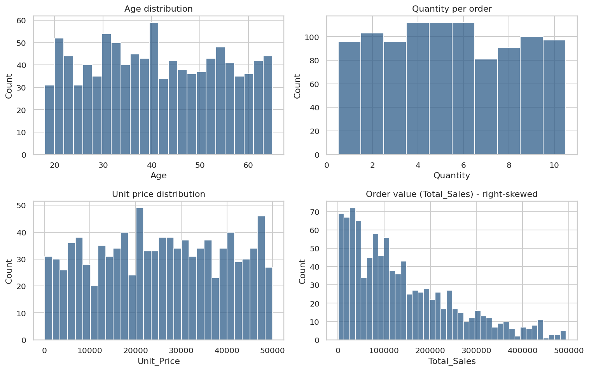
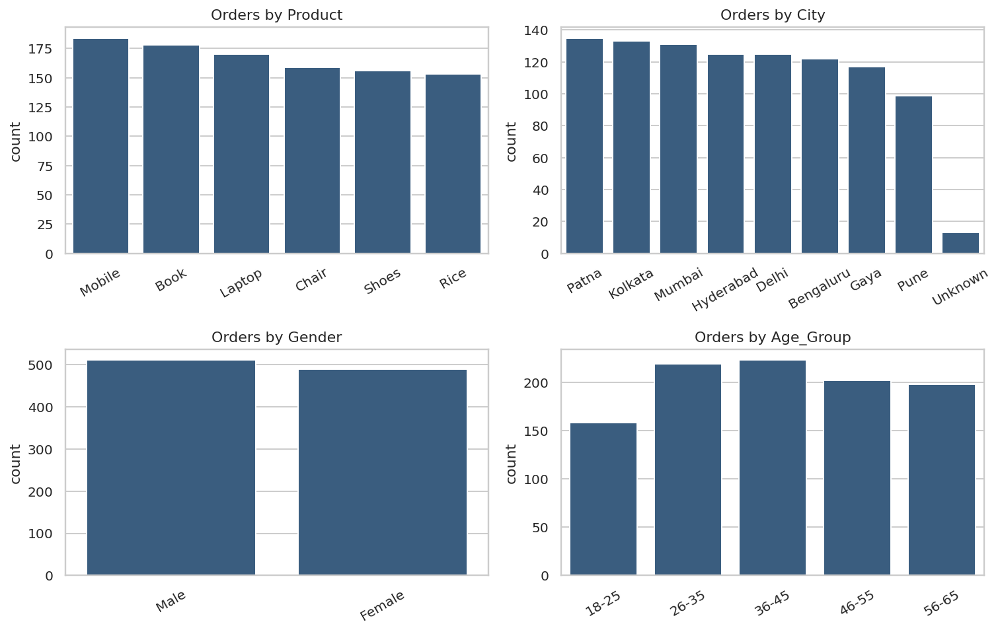
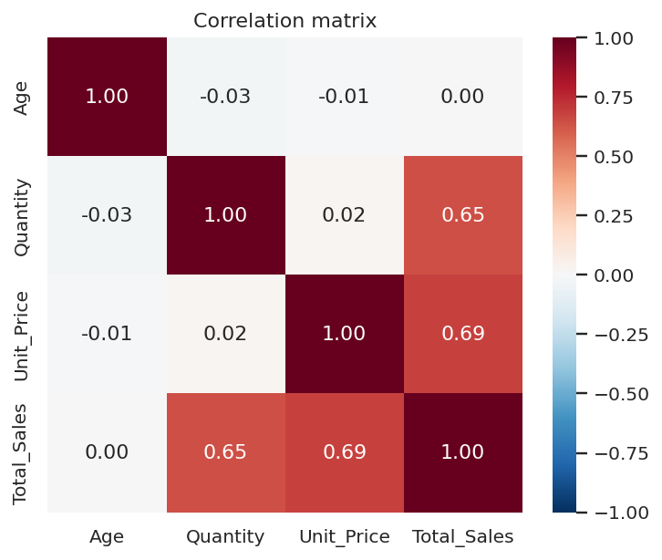
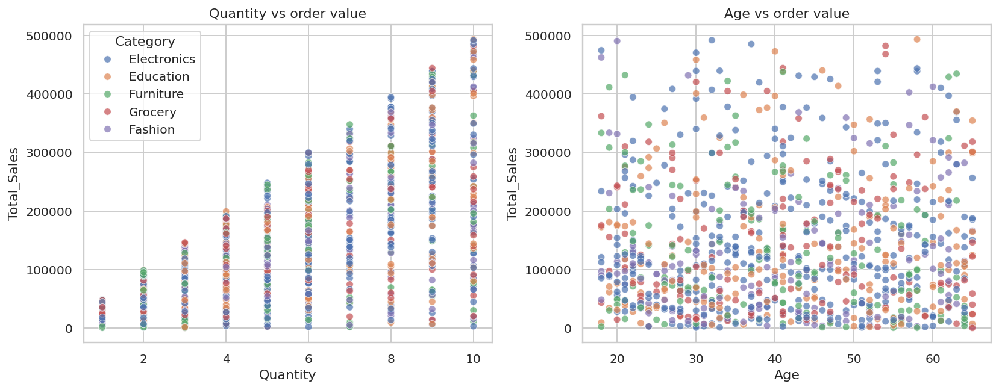
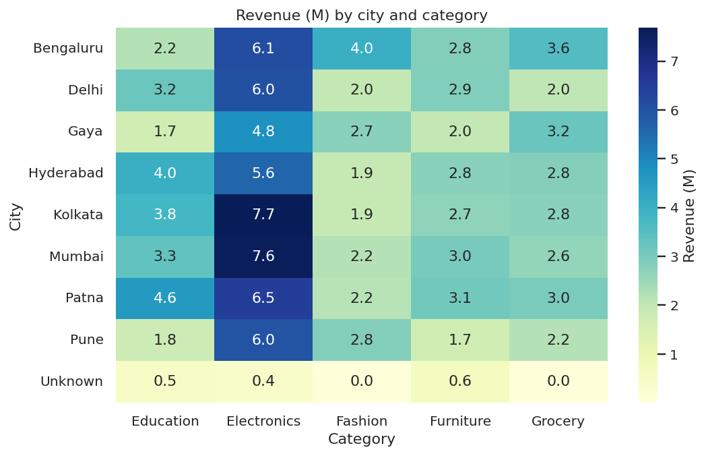
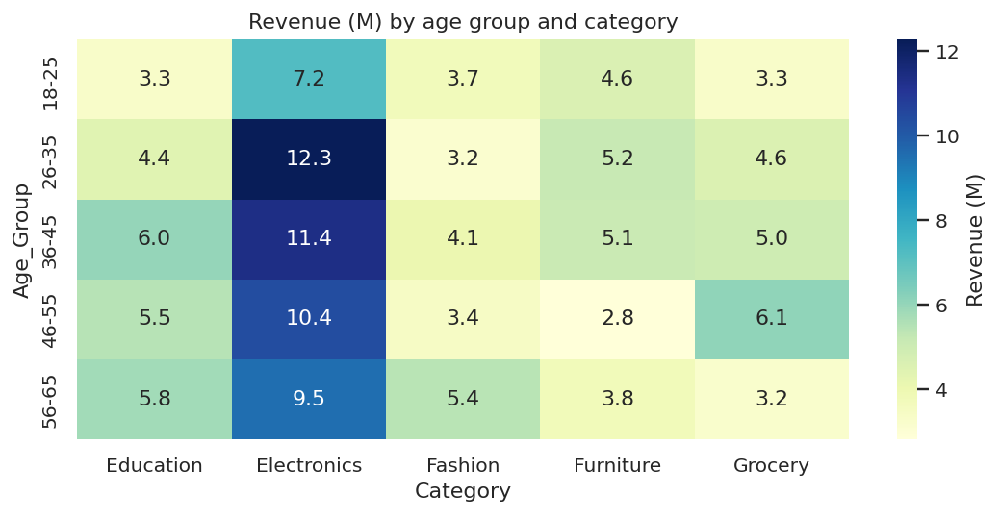
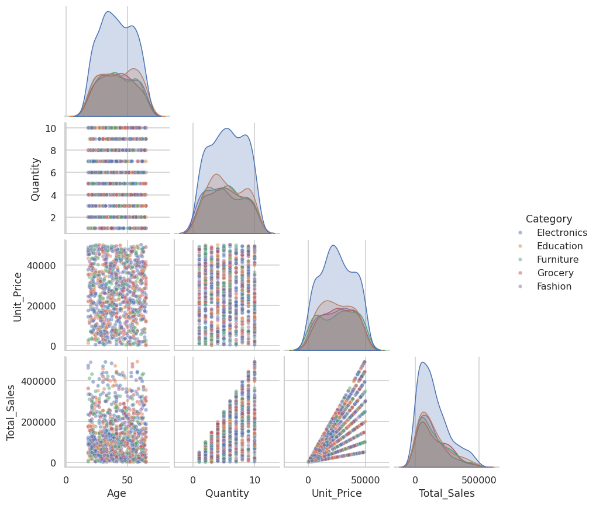
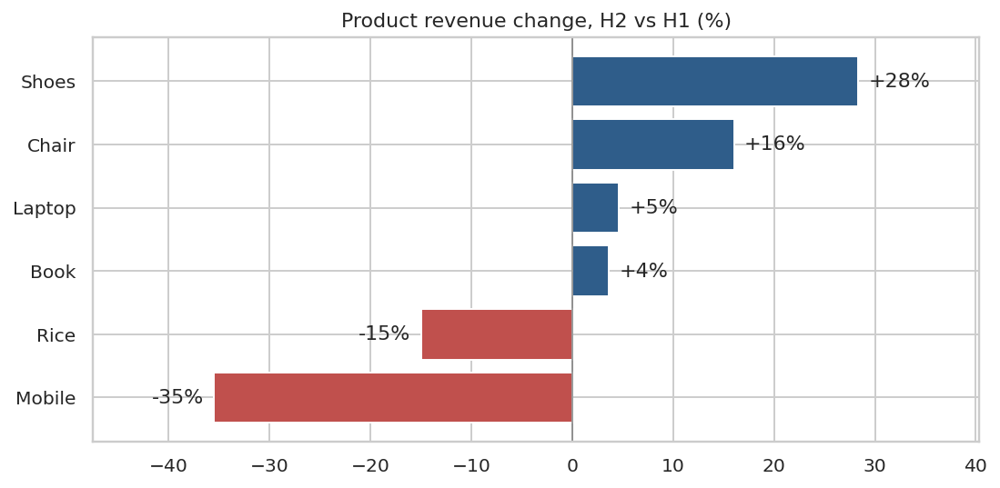
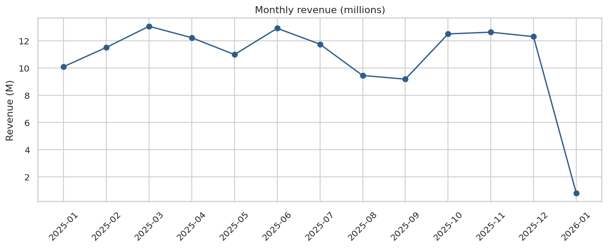
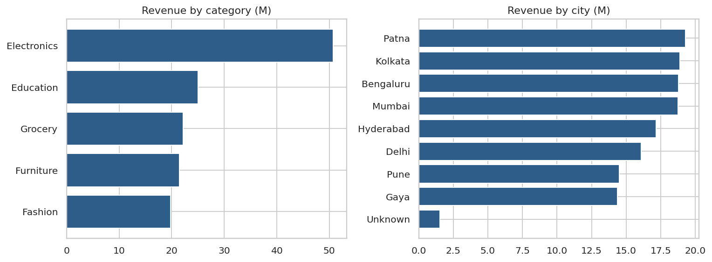

# Exploratory Data Analysis Report

**Task 2 - EDA & Business Intelligence | ApexPlanet Data Analytics Internship | Author: Mahesh R**

**Data:** cleaned sales dataset from Task 1 (1,000 orders, 1 Jan 2025 - 1 Jan 2026, 8 cities, 6 products, 5 categories).
All numbers below are produced by `src/eda_analysis.py` and `src/sql_analysis.py`; full tables are in `statistics_tables.md` and `../sql/query_results.md`.

---

## 1. Headline numbers

| Metric | Value |
|---|---|
| Total revenue | 139.4 M |
| Orders | 1,000 |
| Average order value (mean / median) | 139,399 / 108,594 |
| Units per order (mean) | 5.4 |
| Customers' average age | 41.4 years |

## 2. Descriptive statistics (numeric fields)

| Field | Mean | Median | Std | Min | Max | Skew |
|---|---|---|---|---|---|---|
| Age | 41.35 | 41 | 13.68 | 18 | 65 | 0.04 |
| Quantity | 5.44 | 5 | 2.84 | 1 | 10 | 0.06 |
| Unit_Price | 25,487 | 25,399 | 14,179 | 146 | 49,998 | -0.03 |
| Total_Sales | 139,399 | 108,594 | 114,100 | 437 | 493,678 | 0.99 |

**Reading the table:** Age, Quantity and Unit_Price are close to evenly spread across their ranges (skew near 0). `Total_Sales` is right-skewed (0.99) because it is the product of two independent fields, so mean (139k) sits well above median (109k).

## 3. Univariate analysis

- **Orders are evenly spread across products** (Mobile 184, Book 178, Laptop 170, Chair 159, Shoes 156, Rice 153) and across genders (51.1% male, 48.9% female).
- **Cities:** Patna (135), Kolkata (133) and Mumbai (131) have the most orders; Pune has the fewest of the named cities (99). 13 orders (1.3%) have an unknown city.
- **Age groups:** 36-45 has the most orders (223); 18-25 the fewest (158), though that band also covers only 8 years versus 10 for the others.
- **Order value:** most orders are below 200,000; the long right tail reaches 493,678.

## 4. Multivariate analysis

| Pair | Correlation | Meaning |
|---|---|---|
| Total_Sales vs Unit_Price | 0.69 | Order value rises with price |
| Total_Sales vs Quantity | 0.65 | ...and almost equally with quantity |
| Quantity vs Unit_Price | 0.02 | Customers do not buy fewer units of pricier items |
| Age vs everything | about 0 (max abs 0.03) | Age does not explain spend |

Price and quantity are independent and contribute about equally to order value, so revenue growth can come from either lever.

## 5. Key insights

1. **Electronics earns 36.4% of revenue** (50.8 M), but only because it holds two products (Mobile and Laptop). Per product, revenue is nearly flat: Laptop 18.3%, Mobile 18.2%, Book 18.0%, Rice 15.9%, Chair 15.4%, Shoes 14.2%.
2. **Mobile is losing momentum.** Mobile revenue fell 35% from H1 to H2 2025 (15.4 M to 9.9 M; orders 106 to 78). Rice fell 15%. Shoes (+28%) and Chair (+16%) grew. As a result, Mobile is the only product missing from the last-6-month top 5 (SQL Q1), despite ranking 2nd for the full year.

   

3. **Revenue is moderately concentrated.** The top 10% of orders bring in 27.6% of revenue, the top 30% bring 61.6%, and the bottom half only 18.1% (SQL Q7). The 19 statistical outliers alone are 6.3% of revenue.
4. **Seasonality: a mid-year dip.** Q3 is the weakest quarter (30.4 M, 21.8%) against Q4 (37.4 M, 26.8%). August fell 19.6% month over month and September was the lowest month (9.2 M); October rebounded 36.2%.

   

5. **December: most orders, lower value.** December had the highest order count (98) but an average order value of 125.5 k, below the yearly average of 139.4 k. (2026-01 holds only 5 orders from 1 January, so ignore its month-over-month figure.)
6. **No weekend effect.** Weekends see 2.77 orders per day vs 2.72 on weekdays (SQL Q6).
7. **Geography:** Patna leads revenue (19.3 M, 13.8%). Bengaluru has the highest average order value (153.9 k) while Gaya has the lowest (122.9 k) and the lowest revenue of the named cities (14.4 M).
8. **Demographics:** the 36-45 group is the biggest revenue segment (31.5 M, 22.6%). Electronics is the top category in every age group (SQL Q5). Gender split is 52% male / 48% female by revenue, with a small average-order-value gap (141.8 k vs 136.9 k).

## 6. Recommended KPIs for the dashboard

| KPI | Why it matters |
|---|---|
| Total revenue | Headline performance |
| Orders | Demand volume |
| Average order value | Separates volume growth from value growth |
| Month-over-month revenue growth | Spots dips like Q3 early |
| Top-category revenue share | Concentration risk (Electronics 36.4%) |
| High-value order share (top 10% of orders) | Dependence on large orders (27.6%) |

The static mock-up is in `../dashboard/Dashboard_Mockup.pptx`.

## 7. Data caveats

- **Age, Quantity and Unit_Price are close to uniform and unit prices overlap across all products** (a Rice price can match a Laptop price, see `fig09_price_by_product.png`). The data looks synthetic, so product-level pricing conclusions should not be generalised to real markets.
- `Customer_ID` is reused across different names (Task 1), so customer-level analysis is avoided here.
- 13 orders have an unknown city and 20 have an imputed age (flagged in the data).
- Differences such as gender or weekday gaps are small and have not been tested statistically; hypothesis testing is covered in Task 4.
